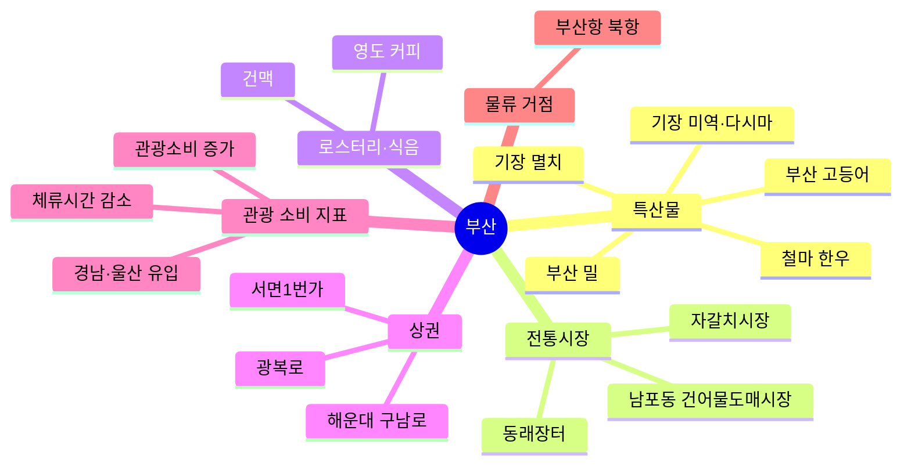

# 부산 지역 키워드 맵 · 김지윤 · AX 데이터·서비스 트랙

> 키워드 하나 = 리서치 노트 하나. 노트를 만들면 '노트' 칸에 파일 이름을 적습니다.
> 출처를 확인하지 못한 키워드는 '상태'에 `확인 필요`로 둡니다.
> 키워드는 12개 이상 채웁니다.

- 작성일: 2026-11-12
- 근거 범위: `inputs/` 폴더 CSV 6개만 사용. 웹 페이지는 열지 않았습니다(CSV 안의 홈페이지 주소도 직접 열어 보지 않음).
- 행 번호: 엑셀로 열었을 때의 행 번호(1행 = 컬럼 이름)
- `datalab_*.csv`에는 기준 기간·비교 기준이 적혀 있지 않습니다 → [확인 필요: 데이터랩 지표의 기준 기간과 증감률 비교 대상]

## 가운데 질문

부산을 찾는 20~30대 관광객이 돈을 쓰는 로컬 산업·가게 가운데, 데이터로 문제를 셀 수 있는 리테일 현장은 어디일까?

## 키워드 표

| 묶음 | 키워드 | 왜 골랐나 (크리에이티브: 장면 한 줄 / 데이터·서비스: 셀 수 있는 것·숫자·분모 열) | 근거 (inputs 파일 엑셀 행 또는 URL, 확인일) | 노트 | 상태 |
|---|---|---|---|---|---|
| 특산물 | 기장 미역·다시마 | 축제 기간 2026-04-17~2026-04-19, '미역다시마채취 체험' 있음. 셀 것: 축제 기간 특산물 판매량 / 방문객 수 [확인 필요: 판매·방문객 데이터] | busan_festivals.csv 10행, 2026-11-12 |  | 확인함 |
| 특산물 | 기장 멸치 | 대변항 일원, 2026-04-24~2026-04-26. 셀 것: 멸치 판매량·판매처 수 [확인 필요] | busan_festivals.csv 11행, 2026-11-12 |  | 확인함 |
| 특산물 | 철마 한우 | 축제내용에 '철마한우고기 할인판매+청정 농특산물 직거래판매'가 있어서 판매(리테일) 현장이 직접 드러남. 2026-10-22~2026-10-26 | busan_festivals.csv 39행, 2026-11-12 |  | 확인함 |
| 특산물 | 부산 고등어 | 송도해수욕장, 2026-10-30~2026-11-01. 최근 1년 안의 행사 중 가장 최근에 끝난 특산물 축제 | busan_festivals.csv 41행, 2026-11-12 |  | 확인함 |
| 특산물 | 부산 밀(밀 먹거리) | 부산밀페스티벌, '푸드라운지' 운영. 2026-05-09~2026-05-10. 어떤 메뉴인지는 파일에 없음 [확인 필요: 대표 메뉴] | busan_festivals.csv 12행, 2026-11-12 |  | 확인함 |
| 전통시장 | 자갈치시장 | 부산자갈치축제, 2026-10-15~2026-10-18, 장소가 시장 자체(자갈치시장+유라리광장). 셀 것: 시장 점포 수·축제 기간 매출 [확인 필요] | busan_festivals.csv 30행, 2026-11-12 |  | 확인함 |
| 전통시장 | 남포동 건어물도매시장 | 유라리 건맥축제 장소가 '남포동건어물도매시장'. 도매시장이 관광객용 행사를 연다는 점이 리테일 전환 사례가 될 수 있음 | busan_festivals.csv 24행, 2026-11-12 |  | 확인함 |
| 전통시장 | 동래장터 | 동래읍성역사축제 내용에 '동래장터 체험'이 있음. 2026-10-16~2026-10-18. 상설 시장인지는 파일에 없음 [확인 필요] | busan_festivals.csv 33행, 2026-11-12 |  | 확인함 |
| 로스터리·식음 | 영도 커피 | 영도커피페스티벌, '커피홍보관+세미나+경연대회', 영도구청과 (사)한국커피협회가 함께 엶. 가설: 영도에 커피 업체가 모여 있어서 구청이 축제를 여는 것일 수 있음(파일에는 이유가 없음). 셀 것: 영도 카페·로스터리 점포 수 [확인 필요] | busan_festivals.csv 14행, 2026-11-12 | `research/2026-11-12-yeongdo-coffee.md` | 확인함 |
| 로스터리·식음 | 건맥(건어물+맥주) | 축제내용 '건맥마켓+건맥라운지'. 특산물(건어물)을 20~30대가 좋아할 만한 조합으로 판매하는 사례 [확인 필요: 실제 방문객 연령] | busan_festivals.csv 24행, 2026-11-12 |  | 확인함 |
| 상권 | 서면 상권(서면1번가) | 서면 빛축제, 2025-10-13~2026-02-18로 기간이 길어서 축제 전·중·후 상권 매출을 비교하기 좋음 [확인 필요: 상권 매출 데이터] | busan_festivals.csv 2행, 2026-11-12 | `research/2026-11-12-seomyeon-1st-street.md` | 확인함 |
| 상권 | 광복로 상권 | 광복로겨울빛트리축제, 2026-12-04~2027-01-31(곧 시작). 6주 프로젝트 기간과 겹쳐서 관찰할 수 있음 | busan_festivals.csv 45행, 2026-11-12 |  | 확인함 |
| 상권 | 해운대 구남로 | 해운대 모래축제 장소가 '해운대 해수욕장+구남로'. 2026-05-15~2026-05-18. 해변과 상점가가 붙어 있는 곳 | busan_festivals.csv 13행, 2026-11-12 | `research/2026-11-12-haeundae-gunamro.md` | 확인함 |
| 관광 소비 지표 | 관광소비 증가 | 관광소비 지표 증감률 9.0. 같은 파일에서 체류시간은 -3.2, 목적지 검색량은 -5.8. 가설: 머무는 시간은 줄었는데 쓰는 돈은 늘었을 수 있음(이유는 파일에 없음). 분모: [확인 필요: 기준 기간] | datalab_diagnosis.csv 6행(관광소비), 4행(체류시간), 5행(목적지 검색량), 2026-11-12 |  | 확인 필요 |
| 관광 소비 지표 | 체류시간 감소 | 체류시간 증감률 -3.2, 숙박방문자 증감률 -1.2. 리테일 문제 후보: 관광객이 짧게 머물다 가서 상점에 들르는 시간이 적음 (가설) | datalab_stay.csv 2행, datalab_diagnosis.csv 3·4행, 2026-11-12 | 2026-11-12-stay-time-decline.md | 확인 필요 |
| 관광 소비 지표 | 경남·울산 유입 | 부산으로 들어오는 사람 중 경상남도 64.9, 울산광역시 15.4. 하지만 이 숫자에는 일하러 오는 사람도 섞였을 수 있어서 내 [3] 조건(관광 목적만)으로 나눌 수 없음 | datalab_related_regions.csv 2·3행, 2026-11-12 |  | 확인 필요 |
| 물류 거점(항만) | 부산항 북항 | 부산항축제, 북항친수공원, 2026-06-20~2026-06-21. 항만 공간이 관광객용으로 열리는 사례 | busan_festivals.csv 19행, 2026-11-12 |  | 확인함 |

## 뺀 것

| 뺀 행·키워드 | 이유 |
|---|---|
| busan_festivals.csv 3행 장림항 부네치아 아트프리마켓 | 2025-10-19에 끝남. 내 [2]의 1순위 '최근' 기준(오늘 2026-11-12 기준 1년 안)을 벗어남 |
| busan_festivals.csv 4행 감천문화마을 골목축제 | 2025-10-25에 끝남. 같은 이유(최근 1년 밖) |
| busan_festivals.csv 5행 제28회 UN평화축제 | 2025-10-26에 끝남. 같은 이유(최근 1년 밖) |
| busan_festivals.csv 23행 반송한마음축제 | [3] 제외 조건: 축제내용이 '주민노래자랑…'으로, 관광 목적 방문객보다 동네 주민 대상 행사로 보임(내 판단) |
| busan_festivals.csv 26행 2026 담안골문화축제 | [3] 제외 조건: 같은 이유(주민노래자랑 중심, 주민 대상으로 보임) |
| busan_festivals.csv 36행 제13회 수영강변축제 | [3] 제외 조건: 같은 이유(주민노래자랑 중심, 주민 대상으로 보임) |
| busan_festivals.csv 38행 제5회 반여가을축제 | [3] 제외 조건: 같은 이유(주민노래자랑 중심, 주민 대상으로 보임) |
| datalab_related_regions.csv 17~31행 (유출: 부산 → 다른 지역) | [3] 타깃은 부산에 '오는' 사람이므로, 부산에서 나가는 흐름은 뺌 |
| busan_festivals.csv 15행 해운대모래축제 | 같은 축제 중복 행(13행과 같은 기간). 구남로가 적힌 13행을 남김. [3] 조건이 아니라 정리용 |
| busan_festivals.csv 18행 제24회광안리어방축제 | 같은 축제 중복 행(17행과 같은 기간). 정리용 |
| busan_festivals.csv 28행 부산국제록페스티벌 | 같은 축제 중복 행(27행과 같은 기간). 정리용 |
| busan_festivals.csv 32행 동래읍성역사축제 | 같은 축제 중복 행(33행과 같은 기간). '동래장터 체험'이 적힌 33행을 남김. 정리용 |

## 키워드 사이 연결 (선택)

