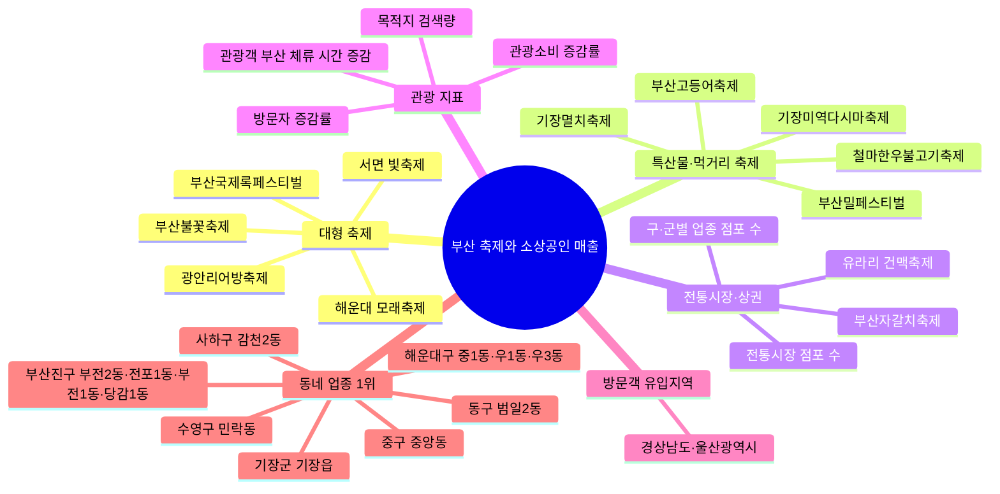

# 부산 지역 키워드 맵 · MinSu · AX 데이터·서비스 트랙

> 키워드 하나 = 리서치 노트 하나. 노트를 만들면 '노트' 칸에 파일 이름을 적습니다.
> 출처를 확인하지 못한 키워드는 '상태'에 `확인 필요`로 둡니다.
> 키워드는 12개 이상 채웁니다.

## 가운데 질문

부산에 축제·관광객이 몰리는 때와 곳에서, 소상공인이 무엇을 세어 보면 매출 기회를 잡을 수 있을까?

## 키워드 표

> 근거의 '엑셀 행'은 머리줄을 1행으로 센 번호입니다. 확인일은 모두 2026-11-17입니다.
> 숫자는 inputs 파일 값을 그대로 옮겼습니다(반올림 없음).

| 묶음 | 분류 | 키워드 | 왜 골랐나 (셀 수 있는 것·숫자·분모) | 근거 (inputs 파일 엑셀 행 또는 URL, 확인일) | 노트 | 상태 |
|---|---|---|---|---|---|---|
| 대형 축제 | 문화 | 부산불꽃축제 | 하루(2026-11-07) 광안리해수욕장. 셀 것: 축제 당일 광안리 근처 가게 매출 / 분모: 평소 같은 요일 매출 | busan_festivals.csv 44행, 2026-11-17 | – | 확인함 |
| 대형 축제 | 문화 | 부산국제록페스티벌 | 3일(2026-10-02~2026-10-04) 삼락생태공원. 셀 것: 축제 기간 사상구 근처 매출 / 분모: 축제 전 주 매출 | busan_festivals.csv 27행, 2026-11-17 | – | 확인함 |
| 대형 축제 | 문화 (부: 자연) | 해운대 모래축제 | 4일(2026-05-15~2026-05-18) 해운대 해수욕장+구남로. 셀 것: 구남로 가게 축제 기간 매출 / 분모: 축제 전 주 매출 | busan_festivals.csv 13행, 2026-11-17 | – | 확인함 |
| 대형 축제 | 문화 (부: 역사) | 광안리어방축제 | 3일(2026-06-12~2026-06-14) 광안리해변 및 수영사적공원 일원. 셀 것: 수영구 가게 축제 기간 매출 / 분모: 축제 전 주 매출 | busan_festivals.csv 18행, 2026-11-17 | – | 확인함 |
| 대형 축제 | 문화 (부: 산업) | 서면 빛축제 | 기간이 긴 축제(2025-10-13~2026-02-18), 장소가 상권 거리(서면1번가). 셀 것: 축제 기간 월별 매출 / 분모: 축제 없는 달 매출 | busan_festivals.csv 2행, 2026-11-17 | – | 확인함 |
| 특산물·먹거리 축제 | 산업 (부: 문화) | 기장멸치축제 | 3일(2026-04-24~2026-04-26) 대변항 일원. 특산물을 파는 가게와 바로 이어짐. 셀 것: 축제 기간 수산물 가게 매출 / 분모: 평소 같은 기간 | busan_festivals.csv 11행, 2026-11-17 | – | 확인함 |
| 특산물·먹거리 축제 | 산업 (부: 문화) | 기장미역다시마축제 | 3일(2026-04-17~2026-04-19) 이동항 일원. 셀 것: 축제 기간 건어물·수산물 가게 매출 / 분모: 평소 같은 기간 | busan_festivals.csv 10행, 2026-11-17 | – | 확인함 |
| 특산물·먹거리 축제 | 산업 (부: 문화) | 부산고등어축제 | 3일(2026-10-30~2026-11-01) 송도해수욕장. 셀 것: 서구 음식점 축제 기간 매출 / 분모: 축제 전 주 매출 | busan_festivals.csv 41행, 2026-11-17 | – | 확인함 |
| 특산물·먹거리 축제 | 산업 (부: 문화) | 철마한우불고기축제 | 5일(2026-10-22~2026-10-26) 철마도시농업공원 일원. 셀 것: 기장군 음식점 축제 기간 매출 / 분모: 축제 전 주 매출 | busan_festivals.csv 39행, 2026-11-17 | – | 확인함 |
| 특산물·먹거리 축제 | 산업 (부: 문화) | 부산밀페스티벌 | 2일(2026-05-09~2026-05-10) 화명생태공원. 셀 것: 빵·카페 가게 축제 기간 매출 / 분모: 평소 같은 주말 | busan_festivals.csv 12행, 2026-11-17 | – | 확인함 |
| 전통시장·상권 | 산업 (부: 문화) | 부산자갈치축제 | 개최장소가 '자갈치시장+유라리광장'인 시장 연계 축제(2026-10-15~2026-10-18). 셀 것: 시장 점포 축제 기간 매출 / 분모: 평소 같은 기간 | busan_festivals.csv 30행, 2026-11-17 | – | 확인함 |
| 전통시장·상권 | 산업 (부: 문화) | 유라리 건맥축제 | 개최장소가 '유라리광장+남포동건어물도매시장'인 시장 연계 축제(2026-09-04~2026-09-05). 셀 것: 건어물 시장 축제 기간 매출 / 분모: 평소 같은 기간 | busan_festivals.csv 24행, 2026-11-17 | – | 확인함 |
| 전통시장·상권 | 산업 (부: 커뮤니티) | 전통시장 점포 수 | 축제장 근처 시장마다 점포가 몇 개인지 = 대시보드의 분모 후보. 부산 158곳, `점포수` 합 24385 (직접 더한 값). 구별 시장 수 부산진구 26, 사상구 17, 중구 16 (지번주소까지 본 값) | busan_markets.csv 2~159행, 2026-11-17 | `research/2026-11-12-busan-dong-industry-store-share.md` | 확인함 |
| 전통시장·상권 | 산업 | 구·군별 업종 점포 수 | 축제가 열리는 구·군에 음식점·카페가 몇 개인지 = 대시보드의 분모 후보. 예: 부산 전체 카페(중분류 비알코올) `점포수` 7071 / 분모 `시군구_전체_점포수` 157296 → `시군구내_비중_퍼센트` 4.50 | busan_commercial_summary.csv 5행, 2026-11-17 | `research/2026-11-12-busan-dong-industry-store-share.md` | 확인함 |
| 관광 지표 | 관광 | 방문자 증감률 | 두 파일 값이 다름: `광역지자체 증감률` 0.8 / `지표 증감률`(방문자유입) 0.9. 같은 지표인지 파일만으로는 알 수 없어 둘 다 적음. 대시보드의 '방문객 흐름' 지표 후보 | datalab_visitors.csv 2행 / datalab_diagnosis.csv 2행, 2026-11-17 | – | 확인함 |
| 관광 지표 | 관광 (부: 산업) | 관광소비 증감률 | `지표 증감률` 9.0 (전년 동기 대비, %). 매출과 가장 가까운 지표. 가설: 방문자 증감률(0.8 / 0.9)보다 크므로, 방문객 한 명이 쓰는 돈이 늘었을 수 있다 | datalab_diagnosis.csv 6행, 2026-11-17 | – | 확인함 |
| 관광 지표 | 관광 | 관광객 부산 체류 시간 증감 | `숙박방문자 증감률` -1.2, `체류시간 증감률` -3.2. diagnosis 파일의 `숙박방문자 비율` -1.2, `체류시간` -3.2와 값이 같음. 가설: 머무는 시간이 줄면 축제 당일 근처 가게가 더 중요해질 수 있다 | datalab_stay.csv 2행 / datalab_diagnosis.csv 3·4행, 2026-11-17 | `research/2026-11-12-overnight-visitors-stay-time.md` | 확인함 |
| 관광 지표 | 관광 | 목적지 검색량 증감률 | `지표 증감률` -5.8. 방문 전 관심도 지표 후보 | datalab_diagnosis.csv 5행, 2026-11-17 | – | 확인함 |
| 방문객 유입지역 | 관광 | 경상남도·울산광역시 유입 | `유입유출 비율` 경상남도 64.9, 울산광역시 15.4. 부산 밖 방문객이 어디서 오는지 = 타깃 방문객 후보 | datalab_related_regions.csv 2·3행, 2026-11-17 | – | 확인함 |
| 동네 업종 1위 | 산업 (부: 커뮤니티) | 기장읍 카페 | 카페 1위 동. 셀 것: `점포수` 175 / 분모: `부산_해당업종_점포수` 7071 → `부산내_비중_퍼센트` 2.47 | busan_commercial_highlights.csv 2행, 2026-11-17 | `research/2026-11-12-busan-dong-industry-store-share.md` | 확인함 |
| 동네 업종 1위 | 산업 | 전포1동 빵/도넛 | 빵/도넛 1위 동. 셀 것: `점포수` 68 / 분모: `부산_해당업종_점포수` 1919 → `부산내_비중_퍼센트` 3.54 | busan_commercial_highlights.csv 17행, 2026-11-17 | `research/2026-11-12-busan-dong-industry-store-share.md` | 확인함 |
| 동네 업종 1위 | 산업 (부: 문화) | 당감1동 떡/한과 | 떡/한과 1위 동. 셀 것: `점포수` 12 / 분모: `부산_해당업종_점포수` 583 → `부산내_비중_퍼센트` 2.06 | busan_commercial_highlights.csv 32행, 2026-11-17 | `research/2026-11-12-busan-dong-industry-store-share.md` | 확인함 |
| 동네 업종 1위 | 산업 | 부전2동 요리 주점 | 요리 주점 1위 동. 셀 것: `점포수` 223 / 분모: `부산_해당업종_점포수` 4080 → `부산내_비중_퍼센트` 5.47 | busan_commercial_highlights.csv 47행, 2026-11-17 | `research/2026-11-12-busan-dong-industry-store-share.md` | 확인함 |
| 동네 업종 1위 | 산업 | 부전2동 생맥주 전문 | 생맥주 전문 1위 동. 셀 것: `점포수` 37 / 분모: `부산_해당업종_점포수` 844 → `부산내_비중_퍼센트` 4.38 | busan_commercial_highlights.csv 62행, 2026-11-17 | `research/2026-11-12-busan-dong-industry-store-share.md` | 확인함 |
| 동네 업종 1위 | 산업 (부: 커뮤니티) | 전포1동 미용실 | 미용실 1위 동. 셀 것: `점포수` 163 / 분모: `부산_해당업종_점포수` 8054 → `부산내_비중_퍼센트` 2.02 | busan_commercial_highlights.csv 77행, 2026-11-17 | `research/2026-11-12-busan-dong-industry-store-share.md` | 확인함 |
| 동네 업종 1위 | 산업 | 전포1동 네일숍 | 네일숍 1위 동. 셀 것: `점포수` 97 / 분모: `부산_해당업종_점포수` 2048 → `부산내_비중_퍼센트` 4.74 | busan_commercial_highlights.csv 92행, 2026-11-17 | `research/2026-11-12-busan-dong-industry-store-share.md` | 확인함 |
| 동네 업종 1위 | 산업 | 부전2동 피부 관리실 | 피부 관리실 1위 동. 셀 것: `점포수` 140 / 분모: `부산_해당업종_점포수` 2616 → `부산내_비중_퍼센트` 5.35 | busan_commercial_highlights.csv 107행, 2026-11-17 | `research/2026-11-12-busan-dong-industry-store-share.md` | 확인함 |
| 동네 업종 1위 | 산업 | 부전2동 화장품 소매업 | 화장품 소매업 1위 동. 셀 것: `점포수` 64 / 분모: `부산_해당업종_점포수` 1671 → `부산내_비중_퍼센트` 3.83 | busan_commercial_highlights.csv 122행, 2026-11-17 | `research/2026-11-12-busan-dong-industry-store-share.md` | 확인함 |
| 동네 업종 1위 | 산업 | 부전2동 여성 의류 소매업 | 여성 의류 소매업 1위 동. 셀 것: `점포수` 363 / 분모: `부산_해당업종_점포수` 2848 → `부산내_비중_퍼센트` 12.75 | busan_commercial_highlights.csv 137행, 2026-11-17 | `research/2026-11-12-busan-dong-industry-store-share.md` | 확인함 |
| 동네 업종 1위 | 산업 | 범일2동 액세서리/잡화 소매업 | 액세서리/잡화 소매업 1위 동. 셀 것: `점포수` 53 / 분모: `부산_해당업종_점포수` 478 → `부산내_비중_퍼센트` 11.09 | busan_commercial_highlights.csv 152행, 2026-11-17 | `research/2026-11-12-busan-dong-industry-store-share.md` | 확인함 |
| 동네 업종 1위 | 산업 | 부전1동 수산물 소매업 | 수산물 소매업 1위 동. 셀 것: `점포수` 55 / 분모: `부산_해당업종_점포수` 466 → `부산내_비중_퍼센트` 11.80 | busan_commercial_highlights.csv 167행, 2026-11-17 | `research/2026-11-12-busan-dong-industry-store-share.md` | 확인함 |
| 동네 업종 1위 | 산업 | 기장읍 건어물/젓갈 소매업 | 건어물/젓갈 소매업 1위 동. 셀 것: `점포수` 62 / 분모: `부산_해당업종_점포수` 296 → `부산내_비중_퍼센트` 20.95 | busan_commercial_highlights.csv 182행, 2026-11-17 | `research/2026-11-12-busan-dong-industry-store-share.md` | 확인함 |
| 동네 업종 1위 | 산업 (부: 문화) | 감천2동 기념품점 | 기념품점 1위 동. 셀 것: `점포수` 31 / 분모: `부산_해당업종_점포수` 350 → `부산내_비중_퍼센트` 8.86 | busan_commercial_highlights.csv 197행, 2026-11-17 | `research/2026-11-12-busan-dong-industry-store-share.md` | 확인함 |
| 동네 업종 1위 | 산업 (부: 문화) | 중1동 예술품 소매업 | 예술품 소매업 1위 동. 셀 것: `점포수` 25 / 분모: `부산_해당업종_점포수` 346 → `부산내_비중_퍼센트` 7.23 | busan_commercial_highlights.csv 212행, 2026-11-17 | `research/2026-11-12-busan-dong-industry-store-share.md` | 확인함 |
| 동네 업종 1위 | 산업 (부: 문화) | 전포1동 사진촬영업 | 사진촬영업 1위 동. 셀 것: `점포수` 51 / 분모: `부산_해당업종_점포수` 1078 → `부산내_비중_퍼센트` 4.73 | busan_commercial_highlights.csv 227행, 2026-11-17 | `research/2026-11-12-busan-dong-industry-store-share.md` | 확인함 |
| 동네 업종 1위 | 산업 | 민락동 펜션 | 펜션 1위 동. 셀 것: `점포수` 206 / 분모: `부산_해당업종_점포수` 1583 → `부산내_비중_퍼센트` 13.01 | busan_commercial_highlights.csv 242행, 2026-11-17 | `research/2026-11-12-busan-dong-industry-store-share.md` | 확인함 |
| 동네 업종 1위 | 산업 | 우1동 호텔/리조트 | 호텔/리조트 1위 동. 셀 것: `점포수` 32 / 분모: `부산_해당업종_점포수` 262 → `부산내_비중_퍼센트` 12.21 | busan_commercial_highlights.csv 257행, 2026-11-17 | `research/2026-11-12-busan-dong-industry-store-share.md` | 확인함 |
| 동네 업종 1위 | 산업 | 중앙동 여행사 | 여행사 1위 동. 셀 것: `점포수` 90 / 분모: `부산_해당업종_점포수` 1015 → `부산내_비중_퍼센트` 8.87 | busan_commercial_highlights.csv 272행, 2026-11-17 | `research/2026-11-12-busan-dong-industry-store-share.md` | 확인함 |
| 동네 업종 1위 | 산업 (부: 자연) | 우3동 수상/해양 레저업 | 수상/해양 레저업 1위 동. 셀 것: `점포수` 42 / 분모: `부산_해당업종_점포수` 77 → `부산내_비중_퍼센트` 54.55 | busan_commercial_highlights.csv 287행, 2026-11-17 | `research/2026-11-12-busan-dong-industry-store-share.md` | 확인함 |

### 분류 까닭

- 부산불꽃축제 · 문화: 하루 열리는 공연형 축제라 문화로 둠 (busan_festivals.csv 44행).
- 부산국제록페스티벌 · 문화: 음악 공연 축제라 문화로 둠 (busan_festivals.csv 27행).
- 해운대 모래축제 · 문화 (부: 자연): 축제라 문화, 개최장소가 '해운대 해수욕장'이라 자연에도 걸침 (13행).
- 광안리어방축제 · 문화 (부: 역사): 축제라 문화, 개최장소에 '수영사적공원'이 있어 역사에도 걸침. '어방'의 뜻은 파일에서 확인하지 않음 (18행).
- 서면 빛축제 · 문화 (부: 산업): 축제라 문화, 개최장소가 상권 거리 '서면1번가'라 산업에도 걸침 (2행).
- 기장멸치축제 · 산업 (부: 문화): 수산 특산물을 파는 일과 이어져 산업, 축제라 문화에도 걸침 (11행).
- 기장미역다시마축제 · 산업 (부: 문화): 수산 특산물과 이어져 산업, 축제라 문화에도 걸침 (10행).
- 부산고등어축제 · 산업 (부: 문화): 수산물 이름을 건 축제라 산업, 축제라 문화에도 걸침 (41행).
- 철마한우불고기축제 · 산업 (부: 문화): 축산물·음식 판매와 이어져 산업, 축제라 문화에도 걸침 (39행).
- 부산밀페스티벌 · 산업 (부: 문화): 식재료(밀) 이름을 건 축제라 산업, 축제라 문화에도 걸침. 축제 내용은 파일에서 확인하지 않음 (12행).
- 부산자갈치축제 · 산업 (부: 문화): 개최장소가 '자갈치시장'이라 시장 장사와 이어져 산업, 축제라 문화에도 걸침 (30행).
- 유라리 건맥축제 · 산업 (부: 문화): 개최장소가 '남포동건어물도매시장'이라 산업, 축제라 문화에도 걸침 (24행).
- 전통시장 점포 수 · 산업 (부: 커뮤니티): 점포 수는 장사 규모라 산업, 시장은 동네 사람이 모이는 곳이라 커뮤니티에도 걸침.
- 구·군별 업종 점포 수 · 산업: 업종별 점포 수라 산업.
- 방문자 증감률 · 관광: 부산을 찾은 방문자 수의 변화를 세는 관광 지표라 관광 (datalab_visitors.csv 2행, datalab_diagnosis.csv 2행).
- 관광소비 증감률 · 관광 (부: 산업): 관광 지표라 관광, 방문객이 쓴 돈의 변화라 산업에도 걸침 (datalab_diagnosis.csv 6행).
- 관광객 부산 체류 시간 증감 · 관광: 방문객이 머무는 시간·숙박의 변화를 세는 관광 지표라 관광 (datalab_stay.csv 2행).
- 목적지 검색량 증감률 · 관광: 부산을 여행지로 찾아보는 관심도 지표라 관광. 무엇을 검색한 양인지 정의는 파일에 없음 (datalab_diagnosis.csv 5행).
- 경상남도·울산광역시 유입 · 관광: 방문객이 어느 지역에서 부산으로 오는지 보여 주는 관광 이동 비율이라 관광 (datalab_related_regions.csv 2·3행).
- 기장읍 카페 · 산업 (부: 커뮤니티): 업종 점포 수라 산업, 카페는 동네 사람이 모이는 곳이기도 해 커뮤니티에도 걸침.
- 전포1동 빵/도넛 · 산업: 업종 점포 수라 산업.
- 당감1동 떡/한과 · 산업 (부: 문화): 업종 점포 수라 산업, 떡·한과는 전통 음식이라 문화에도 걸침.
- 부전2동 요리 주점 · 산업: 업종 점포 수라 산업.
- 부전2동 생맥주 전문 · 산업: 업종 점포 수라 산업.
- 전포1동 미용실 · 산업 (부: 커뮤니티): 업종 점포 수라 산업, 동네 주민이 자주 찾는 생활 업종이라 커뮤니티에도 걸침.
- 전포1동 네일숍 · 산업: 업종 점포 수라 산업.
- 부전2동 피부 관리실 · 산업: 업종 점포 수라 산업.
- 부전2동 화장품 소매업 · 산업: 업종 점포 수라 산업.
- 부전2동 여성 의류 소매업 · 산업: 업종 점포 수라 산업.
- 범일2동 액세서리/잡화 소매업 · 산업: 업종 점포 수라 산업.
- 부전1동 수산물 소매업 · 산업: 업종 점포 수라 산업.
- 기장읍 건어물/젓갈 소매업 · 산업: 업종 점포 수라 산업.
- 감천2동 기념품점 · 산업 (부: 문화): 업종 점포 수라 산업, '감천문화마을'(busan_festivals.csv 4행 개최장소, 2025년 종료로 뺀 행)과 이어질 수 있어 문화에도 걸침. [확인 필요: 감천문화마을이 감천2동 안에 있는지. 파일에는 동 이름이 없음]
- 중1동 예술품 소매업 · 산업 (부: 문화): 업종 점포 수라 산업, 예술품을 다뤄 문화에도 걸침.
- 전포1동 사진촬영업 · 산업 (부: 문화): 업종 점포 수라 산업, 사진은 창작 활동이라 문화에도 걸침.
- 민락동 펜션 · 산업: 숙박 업종 점포 수라 산업.
- 우1동 호텔/리조트 · 산업: 숙박 업종 점포 수라 산업.
- 중앙동 여행사 · 산업: 여행 업종 점포 수라 산업.
- 우3동 수상/해양 레저업 · 산업 (부: 자연): 업종 점포 수라 산업, 바다를 쓰는 레저라 자연에도 걸침.

### 묶음 예시

- **AX 크리에이티브 트랙:** 설화·스토리 / 인물 / 캐릭터·IP / 장소·관광 / 축제·행사
- **AX 데이터·서비스 트랙:** 특산물 / 로스터리·양조장 / 전통시장 / 상권 / 물류 거점(항만)

## 뺀 것

| 뺀 행·키워드 | 이유 |
|---|---|
| busan_festivals.csv 엑셀 3행 장림항 부네치아 아트프리마켓 (부산광역시 사하구) | 2025년에 끝난 축제 (종료 2025-10-19) |
| busan_festivals.csv 엑셀 4행 감천문화마을 골목축제 (부산광역시 사하구) | 2025년에 끝난 축제 (종료 2025-10-25) |
| busan_festivals.csv 엑셀 5행 제28회 UN평화축제 (부산광역시 남구) | 2025년에 끝난 축제 (종료 2025-10-26) |
| busan_festivals.csv 엑셀 15행 해운대모래축제 (한국관광공사) | 중복 행: 13행 `2026 제21회 해운대 모래축제`(부산광역시 해운대구)와 날짜·장소가 같음 → 13행을 남김 |
| busan_festivals.csv 엑셀 17행 광안리어방축제 (한국관광공사) | 중복 행: 18행 `제24회광안리어방축제`(부산광역시 수영구)와 날짜·장소가 같음 → 18행을 남김 |
| busan_festivals.csv 엑셀 28행 부산국제록페스티벌 (한국관광공사) | 중복 행: 27행(부산광역시)과 이름·날짜·장소가 같음 → 27행을 남김 |
| busan_festivals.csv 엑셀 32행 동래읍성역사축제 (한국관광공사) | 중복 행: 33행(부산광역시 동래구)과 이름·날짜가 같음 → 33행을 남김 |
| 출처 없는 블로그 글·출처 URL 없는 숫자 | [3] 제외 조건. 이번에는 웹 자료를 쓰지 않아 해당 행 없음 |

> 참고: 엑셀 2행 `서면 빛축제`는 2025-10-13에 시작했지만 2026-02-18에 끝나서 '2025년에 끝난 축제'에 해당하지 않아 남겼습니다.

## 키워드 사이 연결 (선택)

