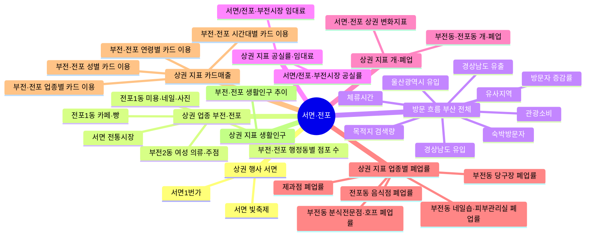

# 부산 지역 키워드 맵 · 조유진 · AX 데이터·서비스 트랙

> 키워드 하나 = 리서치 노트 하나. 노트를 만들면 '노트' 칸에 파일 이름을 적습니다.
> 출처를 확인하지 못한 키워드는 '상태'에 `확인 필요`로 둡니다.
> 키워드는 12개 이상 채웁니다.

## 가운데 질문

서면·전포에서 창업자와 소상공인이 "어디에 어떤 업종으로 들어가고, 기존 가게는 어떻게 대응할지" 판단하려면 어떤 공공데이터 숫자가 필요할까?

## 키워드 표

- 확인일: 2026-11-17
- 근거의 '엑셀 행'은 머리글을 1행으로 센 번호입니다.
- 기준 시점은 CSV 안에는 칸이 없지만 SOURCE.md에 적혀 있습니다(2026-11-17 보충).
  - 데이터랩: 2025-11 ~ 2026-10, 전년 동기 대비
  - 상가(상권)정보: 2026-09 판
  - 전통시장: 데이터기준일자 2026-11-09
- 상태 기준
  - `확인함`: 값과 기준 시점이 모두 확인된 키워드입니다.
  - `확인 필요`: 값이 두 개로 갈리거나, 정의를 알 수 없거나, 근거가 없는 키워드입니다.
- 상가(상권)정보 원본 ZIP(`inputs-team/소상공인시장진흥공단_상가(상권)정보_20260930.zip` 안 `소상공인시장진흥공단_상가(상권)정보_부산_202609.csv`)은 점포 하나가 한 행이고 157,296행입니다. 행 수가 많아 엑셀 행 번호 대신 '센 조건'(열 이름 = 값)을 근거로 적었습니다.

| 묶음 | 분류 | 키워드 | 왜 골랐나 (셀 수 있는 것·숫자·분모 열) | 근거 (inputs 파일 엑셀 행 또는 URL, 확인일) | 노트 | 상태 |
|---|---|---|---|---|---|---|
| 상권 행사 (서면) | 문화 (부: 산업) | 서면 빛축제 | 축제 1건. 기간 2025-10-13~2026-02-18, 장소 서면1번가, 제공기관 부산광역시 부산진구. 축제 기간 전후의 매출과 유동인구를 비교하는 기준점이 됩니다(위험도 진단). | busan_festivals.csv 엑셀 2행, 2026-11-17 |  | 확인함 |
| 상권 행사 (서면) | 산업 (부: 문화) | 서면1번가 | 서면 빛축제의 개최장소이고 도로명주소는 부산진구 중앙대로691번길 10입니다. 서면 안에서 어느 거리를 분석 단위로 삼을지 정할 후보입니다(입지 추천). | busan_festivals.csv 엑셀 2행, 2026-11-17 |  | 확인함 |
| 상권 업종 (부전·전포) | 산업 | 전포1동 카페·빵 | 카페 점포수 154(부산 2위, 부산 카페 7071곳 중 비중 2.18%), 빵/도넛 점포수 68(부산 1위, 1919곳 중 비중 3.54%). 입지·업종 추천에 씁니다. 원본 ZIP으로 다시 세어도 카페 154, 빵/도넛 68로 같습니다. 2026-09 한 시점이라 판단 기준 ②의 '변화'는 이전 판과 비교해야 보입니다. | inputs-team/소상공인시장진흥공단_상가(상권)정보_20260930.zip 안 부산 CSV에서 시군구명=부산진구, 행정동명=전포1동, 상권업종소분류명=카페·빵/도넛으로 센 값(카페 154, 빵/도넛 68) / busan_commercial_highlights.csv 엑셀 3행, 17행(부산 순위·비중: ZIP으로 세지 않아 inputs 사용), 2026-11-17 |  | 확인함 |
| 상권 업종 (부전·전포) | 산업 | 전포1동 미용·네일·사진 | 미용실 163(부산 1위, 8054곳 중 2.02%), 네일숍 97(1위, 2048곳 중 4.74%), 사진촬영업 51(1위, 1078곳 중 4.73%). 같은 업종이 많이 몰린 곳이라 위험도 진단(경쟁 밀도)에 씁니다. 원본 ZIP으로 다시 세어도 미용실 163, 네일숍 97로 같습니다. 원본에서 전포1동 소분류 1위는 미용실(163), 2위는 카페(154)입니다. 기준 시점은 2026-09 판입니다. | inputs-team/소상공인시장진흥공단_상가(상권)정보_20260930.zip 안 부산 CSV에서 행정동명=전포1동으로 센 값(미용실 163, 네일숍 97, 소분류 1·2위) / busan_commercial_highlights.csv 엑셀 77행, 92행, 227행(사진촬영업 51과 부산 순위·비중: ZIP으로 세지 않아 inputs 사용), 2026-11-17 |  | 확인함 |
| 상권 업종 (부전·전포) | 산업 | 부전2동 여성 의류·주점 | 여성 의류 소매업 363(부산 1위, 2848곳 중 12.75%), 요리 주점 223(1위, 4080곳 중 5.47%), 생맥주 전문 37(1위, 844곳 중 4.38%). 폐점 후속 업종 추천의 출발점입니다. 가설: 의류 점포가 많은 거리라서 의류 점포가 문을 닫으면 그 자리가 주점이나 미용 업종으로 바뀔 수 있습니다(개·폐업 데이터로 확인해야 함). 원본 ZIP으로 다시 세어도 여성 의류 363, 요리 주점 223으로 같습니다. 원본에서 부전2동은 소매 1,349곳이 음식 1,312곳보다 많은, 네 동 가운데 유일한 동입니다. 기준 시점은 2026-09 판입니다. (2026-11-17 보충) 같은 동의 카드 데이터에서 2026-09 금액은 여성 1725404301이 남성 1377462315보다 크고, 연령 1·2위는 20대 723777447, 30대 711456086입니다. 다만 업종 API의 의류/잡화 금액은 6866439로 작습니다. | inputs-team/소상공인시장진흥공단_상가(상권)정보_20260930.zip 안 부산 CSV에서 행정동명=부전2동으로 센 값(여성 의류 363, 요리 주점 223, 소매 1,349·음식 1,312) / inputs-team/busan_dongsales_gender·age·biz_bujeon2_20261117.json stdYm=202609 / busan_commercial_highlights.csv 엑셀 137행, 47행, 62행(생맥주 전문 37과 부산 순위·비중: ZIP으로 세지 않아 inputs 사용), 2026-11-17 | `research/2026-11-12-seomyeon-living-population.md` (가설), `research/2026-11-12-seomyeon-card-sales.md` | 확인함 |
| 상권 업종 (부전·전포) | 산업 (부: 역사) | 서면 전통시장 | 부전동·전포동 지번주소의 시장 9곳입니다. 점포수가 가장 많은 곳은 부전상가 740, 서면중앙시장 600입니다. 데이터기준일자는 2026-11-09, 제공기관은 소상공인시장진흥공단입니다. 120행 부전인삼시장과 122행 부전시장은 주소가 같아서 겹치는지 [확인 필요]입니다. 상가 원본의 지번주소와 맞춰 보니 9곳 중 7곳의 행정동을 찾았습니다(부전1동 4곳, 부전2동 1곳, 전포2동 2곳). | busan_markets.csv 엑셀 106, 110, 111, 112, 113, 114, 120, 121, 122행 / 원본 ZIP 부산 CSV 지번주소 대조, 2026-11-17 | `research/2026-11-12-seomyeon-market.md` | 확인함 |
| 상권 업종 (부전·전포) | 산업 | 부전·전포 행정동별 점포 수 | 등록 점포 수: 부전1동 2,759, 부전2동 4,174, 전포1동 2,078, 전포2동 1,347 (합계 10,358). 분모는 부산진구 20,668곳, 부산 전체 157,296곳입니다. 동마다 업종 비교의 분모가 됩니다(입지 추천, 위험도 진단). 점포 수는 영업 여부와 매출을 뜻하지 않습니다. 기준 시점은 2026-09 판입니다. | 원본 ZIP 부산 CSV에서 시군구명=부산진구, 행정동명=부전1동·부전2동·전포1동·전포2동으로 센 값 / https://www.data.go.kr/data/15083033/fileData.do (SOURCE.md에 적힌 주소, 직접 열지 않음), 2026-11-17 | `research/2026-11-12-seomyeon-market.md` (부전1동 2,759곳, 법정동 대응) | 확인함 |
| 방문 흐름 (부산 전체) | 산업 | 방문자 증감률 | 값이 두 개입니다. `광역지자체 증감률` 0.8과 `방문자유입` 지표 증감률 0.9이며, 어느 쪽인지 고르지 않았습니다. 비교 기간은 SOURCE.md 기준 2025-11 ~ 2026-10, 전년 동기 대비입니다. 두 값이 같은 지표인지는 [확인 필요]입니다. | datalab_visitors.csv 엑셀 2행 / datalab_diagnosis.csv 엑셀 2행, 2026-11-17 |  | 확인 필요 |
| 방문 흐름 (부산 전체) | 산업 | 숙박방문자 | `숙박방문자 비율` -1.2, `숙박방문자 증감률` -1.2입니다. 칸 이름이 달라 같은 지표인지는 [확인 필요: 데이터랩 지표 정의]입니다. | datalab_diagnosis.csv 엑셀 3행 / datalab_stay.csv 엑셀 2행, 2026-11-17 |  | 확인 필요 |
| 방문 흐름 (부산 전체) | 산업 | 체류시간 | `체류시간` -3.2, `체류시간 증감률` -3.2입니다. 체류가 짧아지면 머무는 업종보다 빨리 사 가는 업종이 유리한지 볼 출발점입니다(업종 추천). | datalab_diagnosis.csv 엑셀 4행 / datalab_stay.csv 엑셀 2행, 2026-11-17 |  | 확인함 |
| 방문 흐름 (부산 전체) | ? | 목적지 검색량 | 지표 증감률 -5.8로, 다섯 지표 가운데 가장 낮은 값입니다. | datalab_diagnosis.csv 엑셀 5행, 2026-11-17 |  | 확인함 |
| 방문 흐름 (부산 전체) | 산업 | 관광소비 | 지표 증감률 9.0으로, 다섯 지표 가운데 가장 높은 값입니다. 카드매출 데이터와 함께 보면 업종 추천의 근거가 될 수 있습니다. (2026-11-17 보충) 카드매출 노트에서 비교해 보니 부산 전체 값이고 정의도 달라 행정동 카드 금액과 바로 비교할 수 없습니다. | datalab_diagnosis.csv 엑셀 6행, 2026-11-17 | `research/2026-11-12-seomyeon-card-sales.md` (교차검증 칸에서 비교만 함) | 확인함 |
| 방문 흐름 (부산 전체) | 산업 | 경상남도 유입 | 유입유출 비율 64.9로, 15개 유입 지역 가운데 가장 큽니다. 방문객이 어디서 오는지 보여 주는 숫자입니다. | datalab_related_regions.csv 엑셀 2행, 2026-11-17 |  | 확인함 |
| 방문 흐름 (부산 전체) | 산업 | 울산광역시 유입 | 유입유출 비율 15.4로, 유입 지역 가운데 두 번째입니다. | datalab_related_regions.csv 엑셀 3행, 2026-11-17 |  | 확인함 |
| 방문 흐름 (부산 전체) | 산업 | 경상남도 유출 | 유입유출 비율 68.0으로, 15개 유출 지역 가운데 가장 큽니다. 유입 64.9와 같이 놓고 보면 비교할 수 있습니다. | datalab_related_regions.csv 엑셀 17행, 2026-11-17 |  | 확인함 |
| 방문 흐름 (부산 전체) | ? | 유사지역 (울산·서울·대구) | 유사지역 3곳입니다. 서면을 다른 도시 상권과 비교할 때 후보가 됩니다. 어떤 기준으로 '유사'를 정했는지는 [확인 필요: 데이터랩 유사지역 기준]입니다. | datalab_similar_regions.csv 엑셀 2~4행, 2026-11-17 |  | 확인 필요 |
| 상권 지표 (공실률·임대료) | 산업 | 서면/전포·부전시장 공실률 | 판단 기준 ②에 적은 지표입니다. 행정동이 아니라 R-ONE '상권' 단위이고, 분기별 2020Q1~2026Q3 값이 있습니다. 중대형 상가 공실률(%)은 2024Q3 → 2026Q2 → 2026Q3에 서면/전포 15.2 → 11.7 → 12.2, 부전시장 14 → 15.3 → 20.7, 부산 14 → 15.6 → 16.2입니다. 위험도 진단(빈 가게 위험)에 씁니다. 상태가 `확인 필요`인 이유는 세 가지입니다. R-ONE 원문과 직접 대조하지 못했습니다(인증키 없이 부르면 맛보기 5행만 나옴). 상권 경계가 행정동과 어떻게 겹치는지 모릅니다. 2024Q3·2026Q3에 표본이 바뀌었습니다. (2026-11-17 보충, 이전 내용: "근거 없음") (2026-11-17 노트 합친 뒤 보충) 같은 조사를 인용한 기사 두 건과 맞춰 보니 부산 전체 값은 xlsx와 같습니다(2026Q3 일반상가 15.0, 2024Q4 중대형 14.2). 서면/전포 상권 공실률은 기사에 없습니다. 서면/전포 일반상가 1층 공실률은 2024Q3 0.8 → 2026Q3 6.2로 올랐습니다. | inputs-team/부산_서면전포_부전시장_상업용부동산_임대동향_2020-2026.xlsx '공실률' 시트 H23:J23, H30:J30, H31:J31, F23, F31 / https://www.reb.or.kr/r-one/portal/stat/easyStatPage.do (파일에 적힌 출처, 페이지는 열었으나 값은 못 봄) / https://www.metroseoul.co.kr/article/20261029500602 · https://www.busan.com/view/busan/view.php?code=2025020318270520051 (직접 열어 확인), 2026-11-17 | `research/2026-11-17-seomyeon-vacancy-rent.md` | 확인 필요 |
| 상권 지표 (공실률·임대료) | 산업 | 서면/전포·부전시장 임대료 | 입지 추천(진입 비용)과 위험도 진단에 씁니다. 2026Q3 중대형 상가 임대료(천원/㎡, 월)는 서면/전포 50.1, 부전시장 32.5, 부산 30.2입니다. 서면/전포 중대형은 2020Q1 50에서 2026Q3 50.1로 큰 변화가 없습니다. 상태가 `확인 필요`인 이유는 R-ONE 원문 대조를 못 했고, 면적 기준(전용·계약)과 보증금 포함 여부가 [확인 필요]이기 때문입니다. | inputs-team/부산_서면전포_부전시장_상업용부동산_임대동향_2020-2026.xlsx '임대료' 시트 B31:D31, C5 / https://www.reb.or.kr/r-one/portal/stat/easyStatPage.do, 2026-11-17 | `research/2026-11-17-seomyeon-vacancy-rent.md` | 확인 필요 |
| 상권 지표 (개·폐업) | 산업 | 부전동·전포동 개·폐업 | 판단 기준 ②에 적은 지표입니다. 폐점 후속 업종 추천과 이어집니다. 상가(상권)정보 원본 ZIP에는 개업일·폐업일 칸이 없습니다(39개 열 확인). (2026-11-17 보충) 부산광역시 상권 점포이력 API로 법정동 부전동·전포동의 연도별 인허가 / 폐업 수를 셀 수 있습니다. 2022년은 부전동 615 / 355, 전포동 674 / 267입니다. 전포동 폐업은 2019년 152에서 2022년 267로 늘었습니다. 상태가 `확인 필요`인 이유는 세 가지입니다. **데이터가 2023-06-01에서 끝나** 2024~2026년 변화는 없습니다. 행정동이 아니라 법정동 기준입니다. 칸 정의 문서를 찾지 못했습니다. | inputs-team/busan_commercial_history_20261117/page_0001~0337.json (API 응답 원본, 호출일 2026-11-17), rdnwhladdr 끝 괄호=부전동·전포동으로 센 값 / https://apis.data.go.kr/6260000/BusanCommercialHistoryService/getCommercialHistoryList (호출 주소, 상세 페이지 못 찾음), 2026-11-17 | `research/2026-11-17-seomyeon-store-openclose.md` | 확인 필요 |
| 상권 지표 (업종별 폐업률) | 산업 | 제과점 폐업률 (부전동·전포동) | 프롬프트 ③ 1순위 기준(분기 폐업 건수 ÷ 분기 초 영업 점포 수)의 2023Q1 상위 2·3위입니다. 부전동 2 / 35 = 5.71%, 전포동 2 / 36 = 5.56% (계산값). 타깃인 디저트 창업자에게 위험 업종 후보입니다. 분자가 2건뿐이고 법정동 기준이라 `확인 필요`입니다. | inputs-team/busan_commercial_history_20261117/page_0059.json 571·714·715·793번째 항목 (JSON이라 엑셀 행 번호 없음), 2026-11-17 | `research/2026-11-12-seomyeon-closure-rate.md` | 확인 필요 |
| 상권 지표 (업종별 폐업률) | 산업 | 부전동 분식전문점·호프 폐업률 | 2023Q1 상위 8·9위입니다. 분식전문점 27 / 847 = 3.19%(2022Q4도 3.19%), 호프·간이주점 7 / 220 = 3.18%. 분모가 커서 값이 안정적입니다. 같은 분기에 열고 닫은 분식전문점 11곳(마카롱·빵·떡집 포함)은 팝업 매장일 수 있습니다(가설). | inputs-team/busan_commercial_history_20261117/page_0001~0337.json 가운데 rdnwhladdr 끝 괄호=부전동, minornm=분식전문점·호프·간이주점, dcbymd 2023Q1 (분식전문점은 page_0001·0002·0176·0283 등 18개 파일), 2026-11-17 | `research/2026-11-12-seomyeon-closure-rate.md` | 확인 필요 |
| 상권 지표 (업종별 폐업률) | 산업 | 부전동 네일숍·피부관리실 폐업률 | 2023Q1 상위 5·6위입니다. 네일숍 4 / 94 = 4.26%, 피부관리실 7 / 169 = 4.14% (2022Q4 3.19%, 1.91%). 키워드 '전포1동 미용·네일·사진'(경쟁 밀도)과 함께 보면 위험도 진단에 씁니다. | inputs-team/busan_commercial_history_20261117/page_0070·0073·0085·0087.json(네일숍), page_0070~0073·0086.json(피부관리실), dcbymd 2023Q1, 2026-11-17 | `research/2026-11-12-seomyeon-closure-rate.md` | 확인 필요 |
| 상권 지표 (업종별 폐업률) | 산업 | 전포동 음식점(일식·중식·양식) 폐업률 | 2023Q1 상위 4·7·10위입니다. 일식음식점 3 / 65 = 4.62%, 중식음식점 1 / 26 = 3.85%, 양식음식점 5 / 164 = 3.05%. 일식·중식은 2022Q4에 0건이라 한 분기만의 값일 수 있습니다. | inputs-team/busan_commercial_history_20261117/page_0225.json 283번째, page_0282.json 594번째, page_0297.json 765번째(일식), page_0330.json 106번째(중식), page_0295·0297·0298·0299.json(양식), 2026-11-17 | `research/2026-11-12-seomyeon-closure-rate.md` | 확인 필요 |
| 상권 지표 (업종별 폐업률) | 산업 | 부전동 당구장 폐업률 | 2023Q1 상위 1위지만 1 / 15 = 6.67%로 폐업 1건뿐입니다(2022Q4는 0 / 15). 타깃 업종이 아니라 판단에는 쓰지 않고, 분자가 작은 업종은 순위가 크게 출렁인다는 예로만 남깁니다. | inputs-team/busan_commercial_history_20261117/page_0141.json 875번째 항목, 2026-11-17 | `research/2026-11-12-seomyeon-closure-rate.md` | 확인 필요 |
| 상권 지표 (개·폐업) | 산업 | 서면·전포 상권 변화지표 | 위험도 진단과 폐점 후속 업종 추천에 씁니다. 부산 상권 477곳마다 변화지표값(다이나믹·상권확장·상권축소·정체)과 평균생존개월수·평균폐업개월수가 있습니다. 부산 평균은 생존 50, 폐업 44개월입니다. 서면역 상권 5곳 중 3곳(서면역_3·4·5)은 '정체'(생존 67·51·72), 전포역은 '다이나믹'(생존 26, 폐업 28), 부전로152번길은 '상권축소'(생존 101, 폐업 35)입니다. 상태가 `확인 필요`인 이유는 세 가지입니다. 데이터 기준 시점이 없습니다. 네 분류의 공식 정의가 없습니다. 상권 경계가 행정동과 어떻게 겹치는지 모릅니다. | inputs-team/busan_commercial_change_20261117.json (API 응답 원본, 호출일 2026-11-17), comm_nm=부산 부산진구 서면역_3~5·전포역, 부전로152번길 / https://www.data.go.kr/data/15095252/openapi.do (직접 열어 확인), 2026-11-17 | `research/2026-11-17-seomyeon-store-openclose.md` | 확인 필요 |
| 상권 지표 (카드매출) | 산업 | 부전·전포 시간대별 카드 이용 | 판단 기준 ②에 적은 지표입니다. 행정동 4곳의 시간대별(00~23시) 월별 일평균 카드 이용금액과 건수가 2023-01~2026-09(45개월) 있습니다. 24시간 금액을 더한 값(avgAmt 합계, 계산값)은 2025-09 → 2026-09에 부전1동 1646999801 → 1960731092, 부전2동 2830292140 → 3102866617, 전포1동 515814594 → 616908187, 전포2동 338229936 → 384031459입니다. 입지 추천(손님이 오는 시간대)과 위험도 진단에 씁니다. 이 API에는 업종별 값이 없습니다(업종별 값은 아래 '업종별 카드 이용' 키워드에 따로 있음, 2026-11-17 보충). 상태가 `확인 필요`인 이유는 금액 단위(원)와 어느 카드사 자료인지 [확인 필요]이기 때문입니다. | inputs-team/busan_dongsales_time_bujeon1·bujeon2·jeonpo1·jeonpo2_20261117.json (API 응답 원본, 호출일 2026-11-17) / https://www.data.go.kr/data/15164416/openapi.do (직접 열어 확인), 2026-11-17 | `research/2026-11-12-seomyeon-card-sales.md` | 확인 필요 |
| 상권 지표 (카드매출) | 산업 | 부전·전포 연령별 카드 이용 | 판단 기준 ②에 적은 지표입니다. 행정동 4곳의 연령대 6구간(20대미만~60대이상) 월별 일평균 카드 이용금액과 건수가 2023-01~2026-09(45개월) 있습니다. 2026-09 금액(avgAmt) 1위 연령은 부전1동 60대이상 1050543480(6개 연령 합계 1960731090), 부전2동 20대 723777447, 전포1동 20대 206051167, 전포2동 60대이상 95940890입니다. 업종 추천(누구를 손님으로 삼을지)에 씁니다. 6개 연령 합계는 시간대 API 합계와 끝자리가 1~4씩 다릅니다(둘 다 노트에 적음). 상태가 `확인 필요`인 이유는 연령이 카드 소유자 기준인지, 금액 단위가 원인지 [확인 필요]이기 때문입니다. | inputs-team/busan_dongsales_age_bujeon1·bujeon2·jeonpo1·jeonpo2_20261117.json (API 응답 원본, 호출일 2026-11-17) / https://www.data.go.kr/data/15164394/openapi.do (직접 열어 확인), 2026-11-17 | `research/2026-11-12-seomyeon-card-sales.md` | 확인 필요 |
| 상권 지표 (카드매출) | 산업 | 부전·전포 성별 카드 이용 | 판단 기준 ②에 적은 지표입니다. 행정동 4곳의 남성·여성 월별 일평균 카드 이용금액과 건수가 2023-01~2026-09(45개월) 있습니다. 2026-09 금액(avgAmt) 남성 / 여성은 부전1동 836657042 / 1124074049, 부전2동 1377462315 / 1725404301, 전포1동 290218285 / 326689901, 전포2동 191024220 / 193007240입니다. 4개 동 모두 여성이 큽니다. 업종 추천에 씁니다. 상태가 `확인 필요`인 이유는 성별이 카드 소유자 기준인지, 법인카드는 어떻게 처리했는지 [확인 필요]이기 때문입니다. | inputs-team/busan_dongsales_gender_bujeon1·bujeon2·jeonpo1·jeonpo2_20261117.json (API 응답 원본, 호출일 2026-11-17) / https://www.data.go.kr/data/15164384/openapi.do (직접 열어 확인), 2026-11-17 | `research/2026-11-12-seomyeon-card-sales.md` | 확인 필요 |
| 상권 지표 (카드매출) | 산업 | 부전·전포 업종별 카드 이용 | 판단 기준 ②와 ③(업종 추천)에 바로 이어지는 지표입니다. 행정동 4곳의 업종 대분류 11개 월별 일평균 카드 이용금액과 건수가 2023-01~2026-09(45개월) 있습니다. 2026-09 금액(avgAmt) 1위는 4개 동 모두 유통(부전1동 239507296, 부전2동 252935853, 전포1동 339492914, 전포2동 293208337)입니다. 세부 업종(카페·네일숍 등)은 없습니다. 상태가 `확인 필요`인 이유는 두 가지입니다. 11개 업종 합계가 시간대 API 합계와 크게 다르고(2026-09 부전1동 569328966 vs 1960731092, 전포1동 847431714 vs 616908187), `음식료품`이 2026-01부터 `음식료픔`으로 표기가 바뀝니다. 파일데이터 설명 4개(업종·시간·연령·성별)는 모두 "카드사 가맹점 행정동별 승인된 결제 건"이라는 같은 문장으로 시작하고, 업종만 기준이 다르다는 말은 없습니다. 그래서 공개 설명으로는 합계 차이를 설명할 수 없습니다. [확인 필요: 부산광역시 빅데이터담당관 문의] (2026-11-17 보충) **쓰는 법:** 확인 전까지는 같은 동 안에서 업종끼리 비율로만 씁니다. 동끼리 금액 비교나 다른 카드 API 금액과 섞는 것은 하지 않습니다. | inputs-team/busan_dongsales_biz_bujeon1·bujeon2·jeonpo1·jeonpo2_20261117.json (API 응답 원본, 호출일 2026-11-17) / https://www.data.go.kr/data/15164434/openapi.do (직접 열어 확인) / https://www.data.go.kr/biz/dcat/metadata/15147853.do (파일데이터 설명, 직접 열어 확인), 2026-11-17 | `research/2026-11-12-seomyeon-card-sales.md` | 확인 필요 |
| 상권 지표 (생활인구) | 커뮤니티 (부: 산업) | 부전·전포 생활인구 추이 | 판단 기준 ②에 적은 지표입니다. 행정동 4곳의 연령대별 월별 일평균 인구가 2023-01~2026-09(45개월) 있습니다. 6개 연령대를 더한 방문인구(vpopAvg 합계, 계산값)는 2025-09 → 2026-09에 부전1동 11016 → 10708, 부전2동 17859 → 17864, 전포1동 5930 → 5973, 전포2동 5995 → 6311입니다. 입지 추천과 위험도 진단에 씁니다. 시간대별 값은 없습니다. 상태가 `확인 필요`인 이유는 두 가지입니다. hpopAvg·wpopAvg·vpopAvg가 주거·직장·방문 인구라는 것은 칸 이름으로 추정한 것이고 [확인 필요: API 칸 정의], 2026-08·09는 같은 행이 두 번씩 들어 있습니다. | inputs-team/busan_dongpop_age_bujeon1·bujeon2·jeonpo1·jeonpo2_20261117.json (API 응답 원본, 호출일 2026-11-17) / https://www.data.go.kr/data/15164376/openapi.do (직접 열어 확인), 2026-11-17 | `research/2026-11-12-seomyeon-living-population.md` | 확인 필요 |

### 분류 까닭

- 서면 빛축제: 문화 (부: 산업) — 빛축제는 행사라 문화입니다. 축제 기간 전후의 매출·유동인구 비교 기준점으로 쓰려고 골라서 산업에도 걸칩니다.
- 서면1번가: 산업 (부: 문화) — 분석 단위로 삼을 상점 거리라 산업입니다. 빛축제가 열리는 장소라 문화에도 걸칩니다.
- 전포1동 카페·빵: 산업 — 카페·빵/도넛 점포 수라서 산업입니다.
- 전포1동 미용·네일·사진: 산업 — 미용실·네일숍·사진촬영업 점포 수와 경쟁 밀도라서 산업입니다.
- 부전2동 여성 의류·주점: 산업 — 의류 소매·주점 점포 수와 카드 금액이라서 산업입니다.
- 서면 전통시장: 산업 (부: 역사) — 시장 점포수라서 산업입니다. 개설연도가 1950~1985년인 오래된 시장들이라 역사에도 걸칩니다.
- 부전·전포 행정동별 점포 수: 산업 — 행정동별 등록 점포 수라서 산업입니다.
- 방문자 증감률: 산업 — 관광 수요(방문자 수 변화)를 보는 지표라 관광산업으로 보고 산업으로 했습니다.
- 숙박방문자: 산업 — 숙박 방문 수요라서 관광·숙박 산업으로 보았습니다.
- 체류시간: 산업 — 머무는 시간을 업종 추천(빨리 사 가는 업종인지)에 쓰려고 고른 지표라 산업입니다.
- 목적지 검색량: ? — 관광 관심도라 산업이나 문화 중 하나일 것 같지만, 데이터랩이 무엇을 검색한 양인지(장소·행사·가게) 정의가 파일에 없어서 정하지 못했습니다.
- 관광소비: 산업 — 관광객의 소비 금액 증감률이라 산업입니다.
- 경상남도 유입: 산업 — 부산으로 오는 방문객의 출발지라 관광 수요(산업)로 보았습니다.
- 울산광역시 유입: 산업 — 경상남도 유입과 같은 이유로 관광 수요(산업)로 보았습니다.
- 경상남도 유출: 산업 — 부산 사람이 나가는 곳이라 관광 수요(산업)로 보았습니다.
- 유사지역 (울산·서울·대구): ? — 데이터랩이 어떤 기준(인구·관광·산업 구조 등)으로 '유사'를 정했는지 파일에 없어서 정하지 못했습니다.
- 서면/전포·부전시장 공실률: 산업 — 상가 공실률이라 산업(부동산·상권)입니다.
- 서면/전포·부전시장 임대료: 산업 — 상가 임대료라 산업입니다.
- 부전동·전포동 개·폐업: 산업 — 점포 인허가·폐업 건수라서 산업입니다.
- 제과점 폐업률 (부전동·전포동): 산업 — 업종별 폐업률이라 산업입니다.
- 부전동 분식전문점·호프 폐업률: 산업 — 업종별 폐업률이라 산업입니다.
- 부전동 네일숍·피부관리실 폐업률: 산업 — 업종별 폐업률이라 산업입니다.
- 전포동 음식점(일식·중식·양식) 폐업률: 산업 — 업종별 폐업률이라 산업입니다.
- 부전동 당구장 폐업률: 산업 — 업종별 폐업률이라 산업입니다. 놀이 시설이지만 여기서는 폐업률 숫자의 예로만 써서 문화로 보지 않았습니다.
- 서면·전포 상권 변화지표: 산업 — 상권별 점포 생존·폐업 개월수라서 산업입니다.
- 부전·전포 시간대별 카드 이용: 산업 — 카드 결제 금액·건수라서 산업입니다.
- 부전·전포 연령별 카드 이용: 산업 — 연령별로 나눴지만 결제 금액·건수 지표라 산업입니다.
- 부전·전포 성별 카드 이용: 산업 — 성별로 나눴지만 결제 금액·건수 지표라 산업입니다.
- 부전·전포 업종별 카드 이용: 산업 — 업종별 결제 금액·건수라서 산업입니다.
- 부전·전포 생활인구 추이: 커뮤니티 (부: 산업) — 그 동에 사는·일하는·찾아오는 사람의 수라 커뮤니티입니다. 상권 손님 수요로도 써서 산업에도 걸칩니다.

### 묶음 예시

- **AX 크리에이티브 트랙:** 설화·스토리 / 인물 / 캐릭터·IP / 장소·관광 / 축제·행사
- **AX 데이터·서비스 트랙:** 특산물 / 로스터리·양조장 / 전통시장 / 상권 / 물류 거점(항만)

## 뺀 것

| 뺀 행·키워드 | 이유 |
|---|---|
| busan_commercial_highlights.csv 300행 중 부전1·2동, 전포1·2동이 아닌 256행 | [3] 제외 조건: 대상 행정동(부전·전포동) 밖의 점포 |
| busan_markets.csv 158행 중 지번주소가 부전동·전포동이 아닌 149행 | [3] 제외 조건: 대상 행정동(부전·전포동) 밖의 점포 |
| 원본 ZIP 부산 CSV 157,296행 중 행정동이 부전1·2동, 전포1·2동이 아닌 146,938행 | [3] 제외 조건: 대상 행정동(부전·전포동) 밖의 점포. 부산진구 전체 20,668곳은 분모로만 썼습니다. |
| 원본 ZIP 안의 부산 외 15개 시도 CSV | 부산이 아니라 열지 않았습니다. |
| busan_markets.csv 엑셀 101행 부전기장골목시장 (위 149행에 포함) | [3] 제외 조건: 이름에 '부전'이 있지만 지번주소가 부산진구 범전동 383-12로 대상 행정동 밖 |
| busan_commercial_summary.csv 1,253행 | [3]에 걸린 것은 아닙니다. 시군구 단위(부산진구 74행)까지만 있어 부전·전포를 따로 볼 수 없어서 키워드 근거로 쓰지 않았습니다. |
| [3]의 나머지 제외 조건(가상·추정 데이터, 직접 설문, 별점만 있거나 상권과 무관한 리뷰, 2024년 이전 리뷰) | 해당 없음. 지금 inputs/의 CSV 9개에는 리뷰 행이나 설문 행이 없습니다. |
| inputs-team/busan_commercial_change_20261117.json 477행 중 대상 밖 상권 (서면·전포·부전 이름이 아닌 곳, 그리고 부산진구 양정역_1·2) | [3] 제외 조건: 대상 행정동(부전·전포동) 밖. 양정역은 이름으로 보아 양정동입니다. 부전기장골목시장은 위의 busan_markets.csv 101행과 같은 이유(범전동)로 뺐습니다. (2026-11-17) |
| busan_festivals.csv 엑셀 3~47행 (45행) | 개최지가 부산진구(서면·전포)가 아닌 축제입니다. 판단 기준 ③(서비스 세 기능)으로 이어지지 않아 뽑지 않았습니다. [3]의 제외 조건에 걸린 것은 아닙니다. 이 안에는 2025년에 끝난 3·4·5행과 같은 축제가 두 번 들어간 행(13·15, 17·18, 27·28, 32·33)이 포함됩니다. |
| datalab_visitors.csv 엑셀 2행 `기초지자체 증감률` | 값이 빈칸이라 키워드로 쓸 숫자가 없습니다. |
| datalab_related_regions.csv 엑셀 4~16행, 18~31행 | 비율이 작은 지역입니다. 행을 뺀 것이 아니라 키워드로 뽑지 않은 것이고, 값은 파일에 그대로 있습니다. |

## 키워드 사이 연결 (선택)

